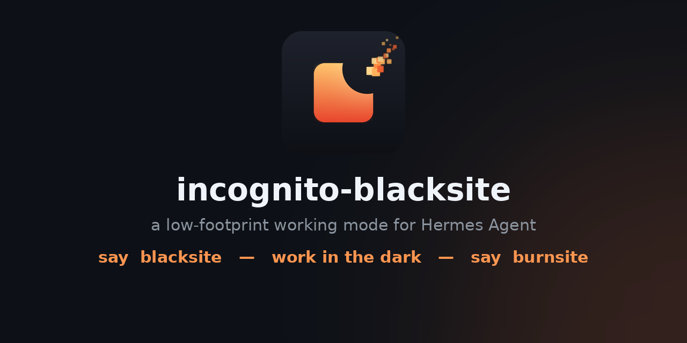

<p align="center"></p>

# 🔥 incognito-blacksite — a low-footprint working mode for [Hermes Agent](https://hermes-agent.nousresearch.com)

Say **`blacksite`**, work in the dark, say **`burnsite`**, and the session reverses itself and self-immolates.

A skill for [Hermes Agent](https://hermes-agent.nousresearch.com) (by Nous Research) that opens an **incognito working window**: zero durable writes while active, every side effect ledgered *before* it lands, and at close the ledger walks backwards — restoring edited files from backups, deleting created ones — then `shred -u`s the entire session directory. An opt-in **RAM mode** puts the whole workspace on tmpfs so nothing touches disk at all.

## Why this exists

Agent memory is generous: persistent notes, learned skills, scheduled jobs, config edits. Useful — until a session is one you'd rather it *didn't* remember. Browser incognito only hides history; this skill **isolates, tracks, and reverses**. Easily to toggle with simple keywords.

## Quick start

```bash
# from your Hermes chat — the keyword works mid-sentence:
you> blacksite
hermes> ◼ BLACKSITE ACTIVE — nothing persists.
...work happens only in the session dir; outside actions get ledgered first...
you> burnsite
hermes> ◼ BLACKSITE BURNED — reversed 3 actions, 1 noted; residual list attached.
```

Add `--ram` verbally ("blacksite, ram") to run the session from `/run/user/$UID/incognito/` (tmpfs). The script **refuses to open** if that path isn't actually tmpfs — no silent fallback to disk.

## Status & testing scope

⚠️ **Tested on Linux only** (Ubuntu 26.04, tmpfs + coreutils `shred`). The mechanisms it leans on — `/run/user/$UID` tmpfs, `shred -u`, case-sensitive paths — do not exist the same way on Windows or macOS, and `platforms: [linux]` currently keeps it from loading elsewhere. A Windows port needs different primitives (cipher /s, Volume Shadow Copy caveats, NTFS paths); it's on the roadmap, unproven until tested. Treat any non-Linux use as unverified until then.

## Install

```bash
# Hermes 0.14+ — from a GitHub repo once published:
hermes skills tap add EverythingsComputer/hermes-blacksite
hermes skills install EverythingsComputer/hermes-blacksite/incognito-blacksite

# ...or manually: copy skills/security/incognito-blacksite/ into ~/.hermes/skills/security/
```

Then read the script — it's ~200 lines of stdlib Python, no dependencies, and it's the only part that touches your filesystem. That's deliberate; trust-on-install is not the deal.

## What it does

| Phase | Behavior |
|---|---|
| **open** | Creates `~/.incognito/bs<timestamp>-<rand>/` (or tmpfs with `--ram`, verified) with a mirrored ledger (`LEDGER.jsonl` + `.bak`) |
| **active** | Hard rules: no memory/skill/cron/git writes, no edits outside the session dir without explicit opt-in — and then the target is **backed up first** via the ledger |
| **log** | `create` / `modify` (auto-backup) / `delete` (auto-backup) / misc, always recorded *before* the action executes |
| **keep** | Moves an artifact to an `outbox/` that survives the burn — on the *same medium* as the session |
| **burn** | Dry-run preview → reverse ledger newest→oldest (restore backups, remove creations) → `shred -u` everything in the session dir → rmdir |

## Limitations & considerations (the burn report always lists these)

- **The chat itself**: the conversation transcript lives in your agent's session history and on your messaging platform's servers. The skill offers local transcript deletion; the Telegram/Discord copy is beyond any skill's reach.
- **Outbound effects**: a sent email or a POSTed request is un-undoable — stated at send time, repeated at burn.
- **Swap**: tmpfs pages *can* be swapped (`swapoff` is your call; zram-based setups keep them in RAM).
- **Shred strength**: 1-pass overwrite. Against lab-grade forensic recovery of powered-off media, no software-only tool promises anything.

## Prior art & how this differs

Prior like skills do not implement **pre-isolation + a reversible action ledger**: blacksite can put a *modified* file back the way it was (restore from automatic backup), not merely delete what it made — plus tmpfs mode with enforced verification, the keep/outbox handoff, and a residuals report that tells you exactly what it *couldn't* undo.

## Self-test

No trust required — the pack ships an end-to-end test that creates, modifies, keeps, and burns against disposable temp files and asserts the reversals:

```bash
bash scripts/selftest.sh
```

## Repo layout

```
skills/security/incognito-blacksite/
├── SKILL.md              # the skill: rules, procedure, pitfalls
└── scripts/incog.py      # open / log / keep / list / burn (stdlib only)
scripts/selftest.sh       # end-to-end reversibility test
assets/                   # banner.png (1280x640) + logo.png (1024, transparent)
tools/gen_logo.py         # regenerates both from code: --banner / --strip
```

## Author & license

Built by [Hermes Agent](https://hermes-agent.nousresearch.com) for EverythingsComputer, 2026. MIT — see [LICENSE](LICENSE).

*The well keeps its own counsel.*
